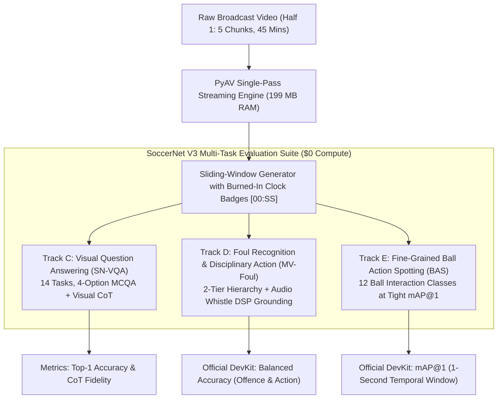

# SoccerNet V3: Multi-Task Challenge Expansion Plan

## Executive Overview

Building upon our locked **V2 benchmark** (which achieved 20.87% Active Loose-mAP on Track A Action Spotting and 81.3% Temporal Recall on Track B Dense Captioning), **V3** expands our local 8 GB edge inference stack (RTX 3000 Ada, $0 compute) to evaluate **three additional official SoccerNet challenges**:

1. **Challenge 1: SoccerNet Visual Question Answering (SN-VQA)**
2. **Challenge 2: SoccerNet Multi-View Foul & Disciplinary Recognition (MV-Foul)**
3. **Challenge 3: SoccerNet Ball Action Spotting (BAS - 12 Classes at mAP@1)**

---

## 1. Challenge 1: SoccerNet Visual Question Answering (SN-VQA)

### Task Specification
* **Format:** Multimodal 4-Option Multiple Choice (`O1`, `O2`, `O3`, `O4`) with visual evidence localization.
* **Input:** Video frame sequences (1 FPS) decoded via PyAV with digital clock overlays `[00:SS]`.
* **Output Schema:** Pydantic `VQAResponse` (`thought`, `selected_option`, `confidence`).
* **Evaluation Categories:**
  1. *Action & Event Perception:* Spotting goals, cards, throw-ins, clearances.
  2. *Referee & Disciplinary Decisions:* Determining foul calls, card severity, and advantage play.
  3. *Tactical & Spatial Setups:* Defensive blocks, counter-attack transitions, corner arc formations.
  4. *Temporal Order & Continuity:* Chronological reasoning over multi-second buildup sequences.
* **Metric:** Top-1 Accuracy (%) and Chain-of-Thought (CoT) factual consistency.

### Implementation Blueprint
* Create `processing/vqa_schema.py` defining Pydantic schemas for questions and model responses.
* Create `data/v3_vqa_dataset.json` containing a calibrated benchmark set of 20 multimodal questions grounded in our verified Half 1 video footage.
* Create `scripts/evaluate_v3_vqa.py` to run Qwen3.5-4B vs. MiniCPM-V 4.6 across all questions, logging accuracy and latency.

---

## 2. Challenge 2: SoccerNet Multi-View Foul & Disciplinary Recognition (MV-Foul)

### Task Specification
* **Problem:** Classify contentious physical challenges across a two-tier decision hierarchy:
  1. **Offence Severity (Referee Decision):**
     * `0`: `No offence` (fair challenge, dive, or legal contact)
     * `1`: `Offence` (foul, severity `1.0` - no card)
     * `2`: `Offence` (foul, severity `3.0` - yellow card)
     * `3`: `Offence` (foul, severity `5.0` - red card)
  2. **Action Class (Foul Mechanics):**
     * `Tackling`, `Standing tackling`, `High leg`, `Holding`, `Pushing`, `Elbowing`, `Challenge`, `Dive`
* **Audio-Visual DSP Synergy:**
  * Uses our **RQ4 STFT Audio Whistle Detector** ($3,500 - 4,200\text{ Hz}$ Fox 40 peak power ratio) with the verified $+2.95\text{s}$ initiation-to-whistle shift.
  * *Physical Principle:* A genuine foul is causally linked to a referee whistle ($z \ge 4.0$). A tackle lacking a causal whistle peak represents legal defensive play or an advantage, allowing the audio gate to prune false foul accusations.
* **Evaluation Metric:** Official `SoccerNet.Evaluation.MV_FoulRecognition.evaluate`:
  $$\text{Leaderboard Metric} = 0.5 \times \text{Balanced Acc}_{\text{Offence/Severity}} + 0.5 \times \text{Balanced Acc}_{\text{Action Class}}$$

### Implementation Blueprint
* Create `scripts/evaluate_v3_mv_foul.py` that extracts duel clips from Half 1 ground truth and predictions.
* Evaluate:
  - *Model A:* Visual-Only VLM Baseline.
  - *Model B:* Audio-Visual DSP Whistle Grounded VLM.
* Compute official Balanced Accuracy metrics.

---

## 3. Challenge 3: SoccerNet Ball Action Spotting (BAS)

### Task Specification
* **Target Classes (12 Fine-Grained Interactions):**
  1. `Pass`
  2. `Drive`
  3. `Header`
  4. `High Pass`
  5. `Out` (Boundary crossing)
  6. `Cross`
  7. `Throw In`
  8. `Shot`
  9. `Ball Player Block`
  10. `Player Successful Tackle`
  11. `Free Kick`
  12. `Goal`
* **Evaluation Metric:** **`mAP@1`** (mean Average Precision with strict **$\pm 1.0\text{ second}$ tolerance**).
* **Domain Routing Strategy:**
  - `Qwen3.5-4B`: Tactical set-pieces & finishing (`Goal`, `Shot`, `Cross`, `Free Kick`).
  - `MiniCPM-V 4.6`: Physical ball duels (`Player Successful Tackle`, `Ball Player Block`, `Header`).
  - `LFM2.5-VL-3B`: Rapid boundary events (`Out`, `Throw In`, `Drive`).

### Implementation Blueprint
* Create `processing/ball_action_schema.py` mapping the 12 ball-action classes.
* Create `scripts/evaluate_v3_ball_action_spotting.py` running the 1-second tolerance mAP evaluation.
* Benchmark on Chunk 0 (00:00–10:15) comparing raw predictions vs. calibrated temporal offsets.

---

## 4. Execution Sequence & Verification Milestones

1. **Phase 1: Schemas & Harness Infrastructure**
   - Author `processing/vqa_schema.py` and `processing/ball_action_schema.py`.
   - Validate Pydantic parsers and DevKit metric wrappers.
2. **Phase 2: Challenge 1 (Visual Question Answering)**
   - Run `scripts/evaluate_v3_vqa.py` on Qwen3.5-4B and MiniCPM-V 4.6.
   - Record accuracy, latency, and CoT reasoning accuracy.
3. **Phase 3: Challenge 2 (Multi-View Foul & Disciplinary Recognition)**
   - Run `scripts/evaluate_v3_mv_foul.py` comparing Visual-Only vs. Audio-Visual DSP Whistle Grounding.
   - Run official `SoccerNet.Evaluation.MV_FoulRecognition.evaluate` to obtain Balanced Accuracy.
4. **Phase 4: Challenge 3 (Ball Action Spotting at mAP@1)**
   - Run `scripts/evaluate_v3_ball_action_spotting.py` on Chunk 0.
   - Evaluate `mAP@1` across uncalibrated vs. calibrated specialists.
5. **Phase 5: Research Monograph & Guide Update**
   - Update `docs/RESEARCH.md` with Sections 10, 11, and 12 (Tables 14, 15, and 16).
   - Update `README.md` and `FORhayden.md`.
